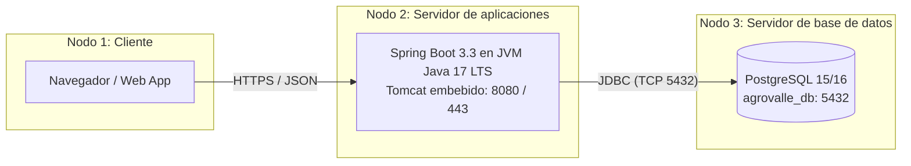

# Arquitectura MVC en 4 capas y patrones GoF/Enterprise — AgroValle Connect

## Capas

| Capa | Paquete | Componentes | Responsabilidad |
|---|---|---|---|
| 1. Presentación / API REST | `controller`, `dto` | `@RestController`, DTOs con `@Valid` | Mapear rutas `/api/v1/...`, validar entrada y responder 201, 200, 400, 404, 409 |
| 2. Lógica de negocio | `service`, `exception` | `@Service`, `@Transactional`, excepciones de dominio | Cédula y correo únicos, cálculos y reglas agrícolas |
| 3. Acceso a datos | `repository` | `@Repository`, `JpaRepository` | CRUD y consultas derivadas (`findByMunicipioIgnoreCaseAndCategoriaIgnoreCase`) |
| 4. Persistencia | PostgreSQL 15/16 | `schema.sql` | Almacenamiento permanente, integridad referencial y ACID |

Regla de dependencias: cada capa solo llama a la inmediatamente inferior. Ningún controlador ejecuta SQL ni procesa reglas de negocio.

## Patrones GoF y Enterprise

- **Repository:** `ProductorRepository` y `ProductoRepository` encapsulan el acceso a datos tras interfaces.
- **Singleton / IoC (Inyección de dependencias):** Spring crea los beans como singleton; las dependencias se inyectan por constructor (`ProductorService`, `ProductoService`, `CalculadorFleteService`).
- **DTO:** `ProductorRegistroDTO`, `ProductorRespuestaDTO` y `ProductoDTO` aíslan las entidades de los contratos JSON. `ProductorRespuestaDTO` no expone la contraseña.
- **Data Mapper / Factory:** `ProductorRespuestaDTO.desde(...)` y `ProductoDTO.desde(...)` convierten entidades en DTO.
- **Strategy (comportamiento, Sprint 2):** `EstrategiaFlete` con una implementación por municipio del Valle del Cauca. Se pueden agregar estrategias sin modificar `CalculadorFleteService` (OCP).

## Diagrama de despliegue

Exportar a PNG para `docs/diseno/diagrama-despliegue.png`.
