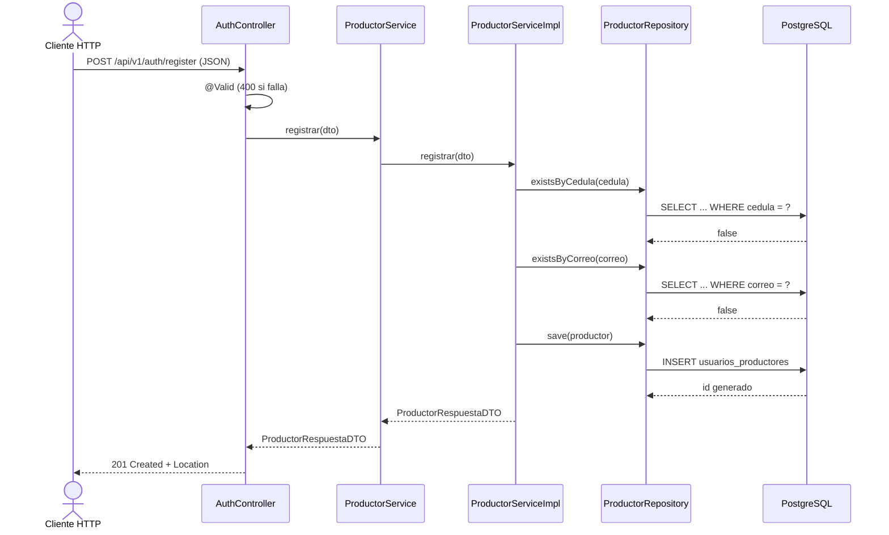
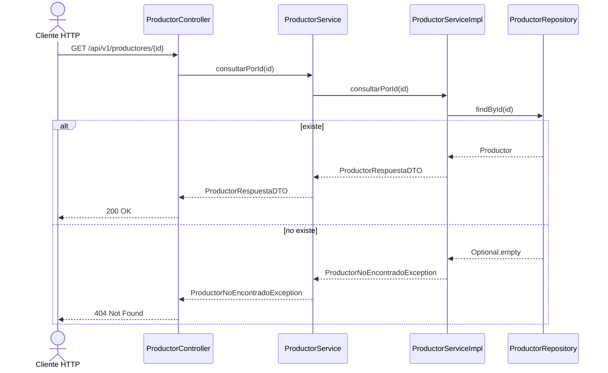
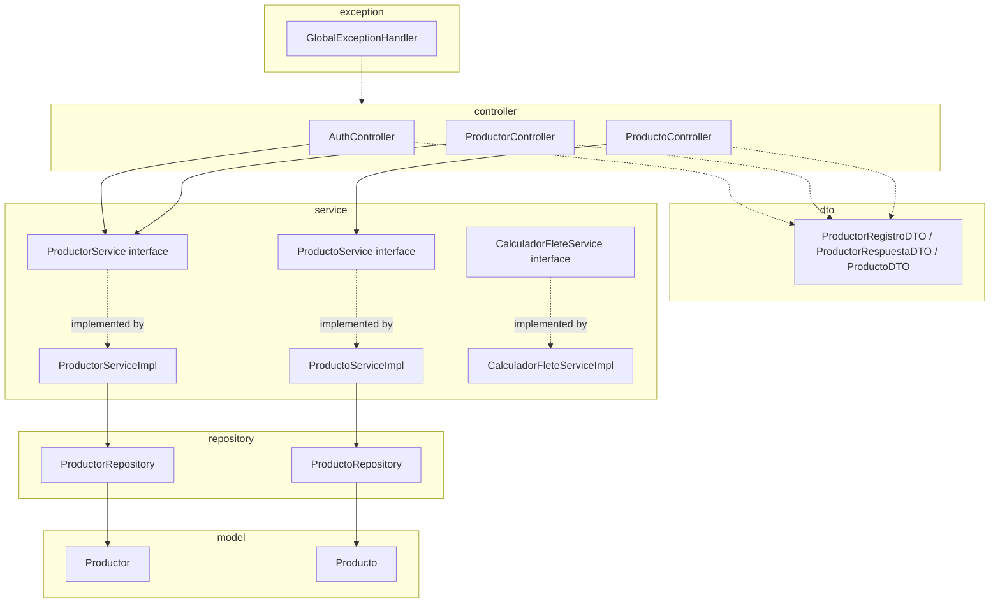
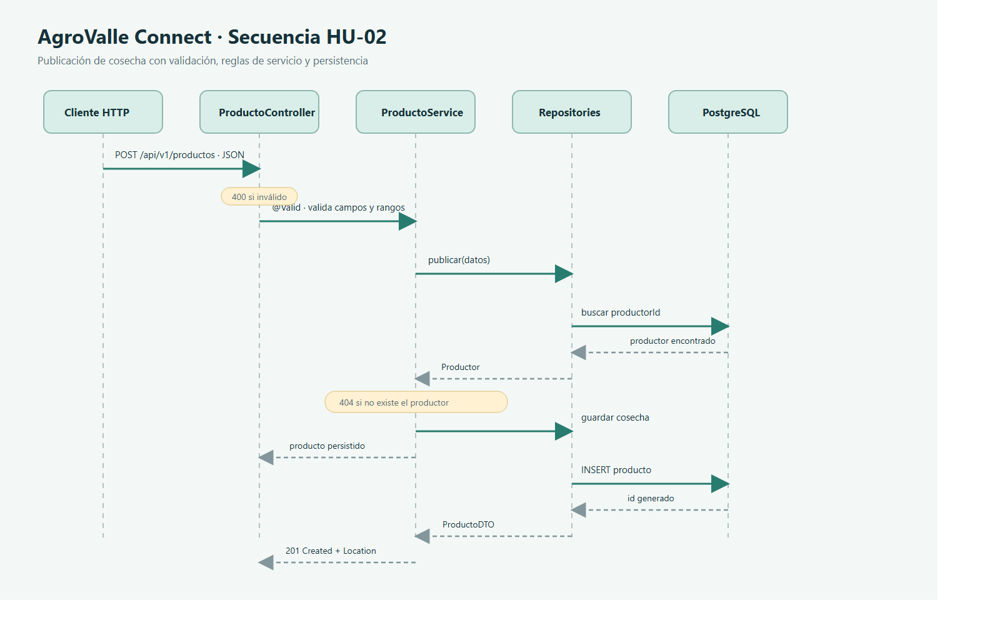
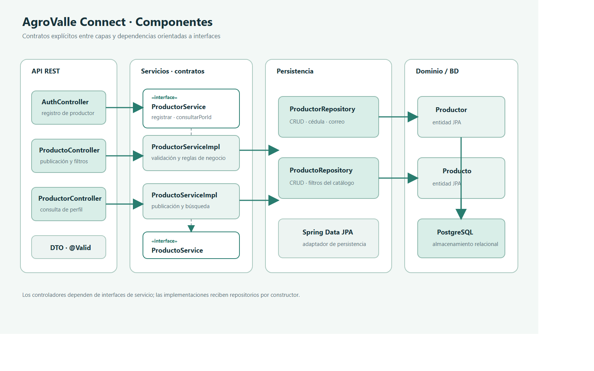

# Diagramas UML de comportamiento y componentes

## Diagrama de secuencia — HU-01 (registro de productor)

## Diagrama de secuencia — HU-07 (consulta de perfil)

## Diagrama de componentes — paquetes Java

Exportar cada diagrama a PNG en `docs/diseno/`: `diagrama-secuencia.png` y `diagrama-componentes.png`.

## Wireframes y mockups

Los mockups de registro, perfil y catálogo con filtros están disponibles en [mockups-ui.pdf](./mockups-ui.pdf); su fuente editable es [mockups-ui.html](./mockups-ui.html). La validación con el Product Owner para la característica de usabilidad (ISO/IEC 25010) queda pendiente.
