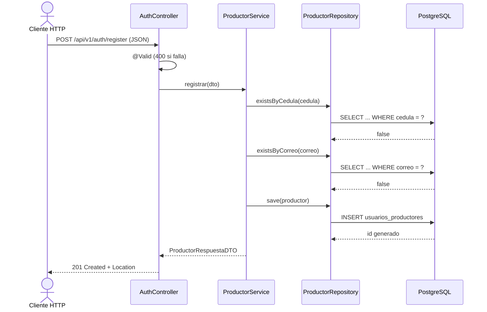
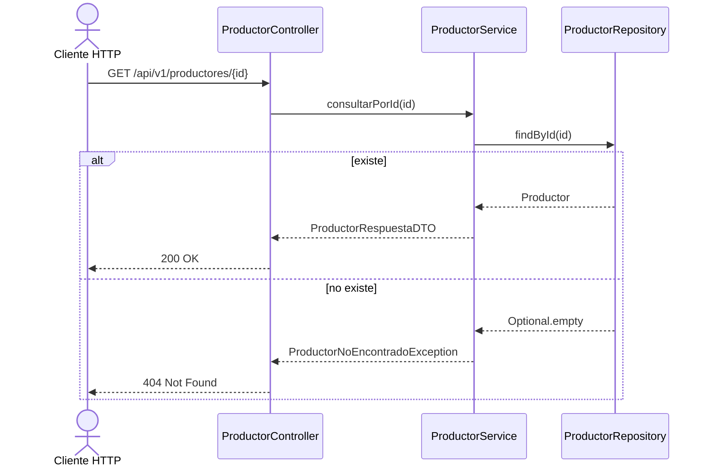
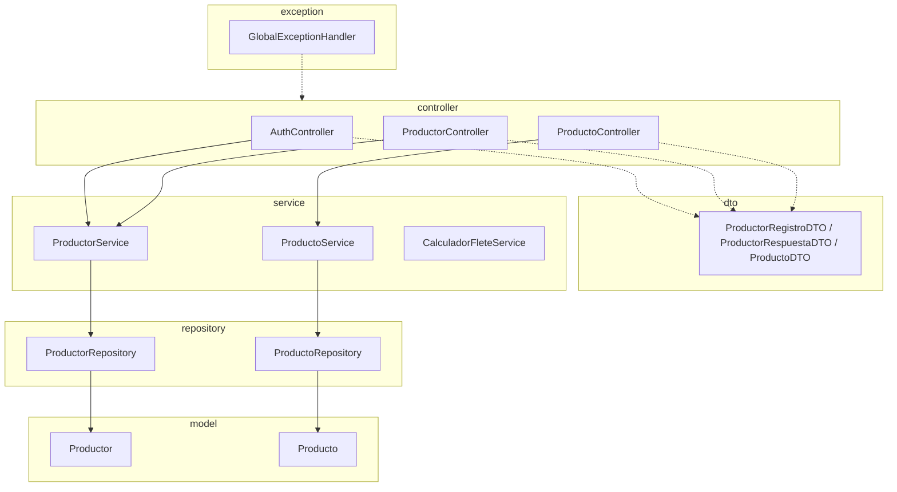

# Diagramas UML de comportamiento y componentes

## Diagrama de secuencia — HU-01 (registro de productor)

## Diagrama de secuencia — HU-07 (consulta de perfil)

## Diagrama de componentes — paquetes Java

Exportar cada diagrama a PNG en `docs/diseno/`: `diagrama-secuencia.png` y `diagrama-componentes.png`.

## Wireframes y mockups

Crear las pantallas principales (registro, perfil y catálogo con filtros) en Figma o similar, exportarlas como PDF a `docs/diseno/mockups-ui.pdf` y validarlas con el Product Owner para la característica de Usabilidad (ISO/IEC 25010).
