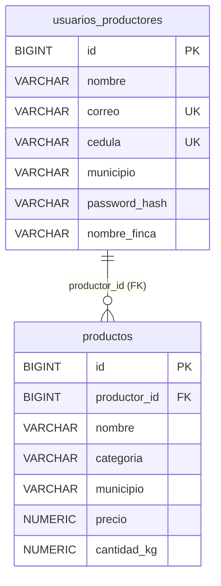

# Diagrama Entidad-Relación (DER) en 3FN — AgroValle Connect

Diseño lógico con claves primarias, foráneas y restricciones. Corresponde a `schema.sql`.

## Justificación de la normalización (3FN)

- **1FN:** todos los atributos son atómicos; no hay listas en una columna.
- **2FN:** todas las tablas tienen clave primaria simple (`id`), por lo que no hay dependencias parciales.
- **3FN:** no hay dependencias transitivas. `productos.municipio` describe el lugar donde se cosecha el producto, que puede diferir del municipio de residencia del productor, por lo que no depende de `productor_id` a través de otro atributo.

## Mapeo JPA

| Tabla | Entidad | Anotaciones |
|---|---|---|
| usuarios_productores | `model.Productor` | `@Entity`, `@Table`, `@Id`, `@GeneratedValue(IDENTITY)`, `@Column` |
| productos | `model.Producto` | igual, más `@ManyToOne` / `@JoinColumn(productor_id)` |
