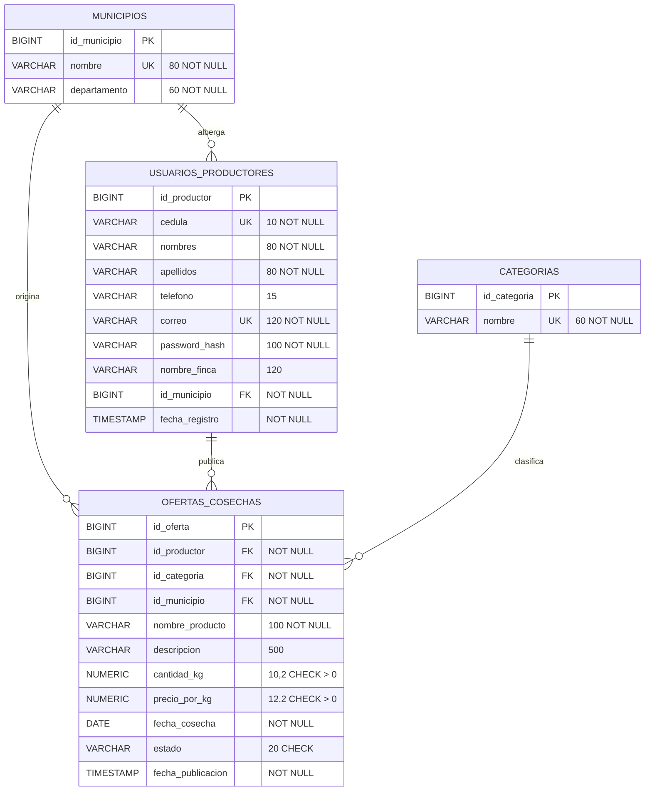

# Diagrama Entidad-Relación lógico (modelo relacional en 3FN) — AgroValle Connect

Modelo lógico relacional basado en el diseño de referencia: catálogos de municipios y categorías, productores y ofertas de cosecha. Las claves primarias usan `BIGINT GENERATED ALWAYS AS IDENTITY`, como PostgreSQL 15/16.

## Claves y cardinalidades

- Cada municipio puede albergar cero o muchos productores; cada productor pertenece a un municipio.
- Cada municipio puede originar cero o muchas ofertas; cada oferta identifica un municipio de origen.
- Cada productor puede publicar cero o muchas ofertas; cada oferta pertenece a un productor.
- Cada categoría puede clasificar cero o muchas ofertas; cada oferta pertenece a una categoría.
- `cedula`, `correo` y los nombres de municipios y categorías se marcan como únicos (UK).

## Justificación de la normalización (3FN)

- **1FN:** los atributos almacenan valores atómicos; no se guardan listas de municipios, categorías ni ofertas en una columna.
- **2FN:** cada tabla tiene una clave primaria simple; sus atributos no clave dependen de la clave completa.
- **3FN:** municipios y categorías se almacenan en catálogos independientes. Las ofertas guardan sus claves foráneas, no los datos descriptivos del municipio o la categoría; los datos de productor dependen de `id_productor` y los datos de oferta de `id_oferta`.

## Compatibilidad con la API existente

El script [schema.sql](./schema.sql) y las entidades JPA implementan este modelo. Se conservan `password_hash` y `nombre_finca` en `usuarios_productores` porque son necesarios para la API de registro existente, aunque no aparecen en la imagen de referencia. Para no romper el contrato HTTP actual, el campo de entrada `nombre` se guarda en `nombres` y `apellidos` queda vacío hasta que la API recoja ambos campos; las fechas de la oferta usan valores por defecto cuando no se envían.

Para una base ya creada con el esquema anterior, hacer copia de seguridad y revisar/ejecutar [schema-migration-v2.sql](./schema-migration-v2.sql) una sola vez. No ejecutar el `schema.sql` de instalación nueva sobre una base existente.
