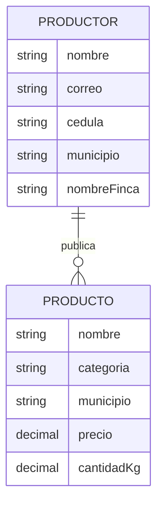

# Modelo Entidad-Relación (MER) — AgroValle Connect

Modelo conceptual: entidades del dominio y su cardinalidad.

Reglas de negocio:
- Un productor publica muchos productos; cada producto pertenece a un único productor.
- La cédula y el correo de un productor son únicos.

Exportar a PNG desde https://mermaid.live para `docs/diseno/modelo-entidad-relacion.png`.
