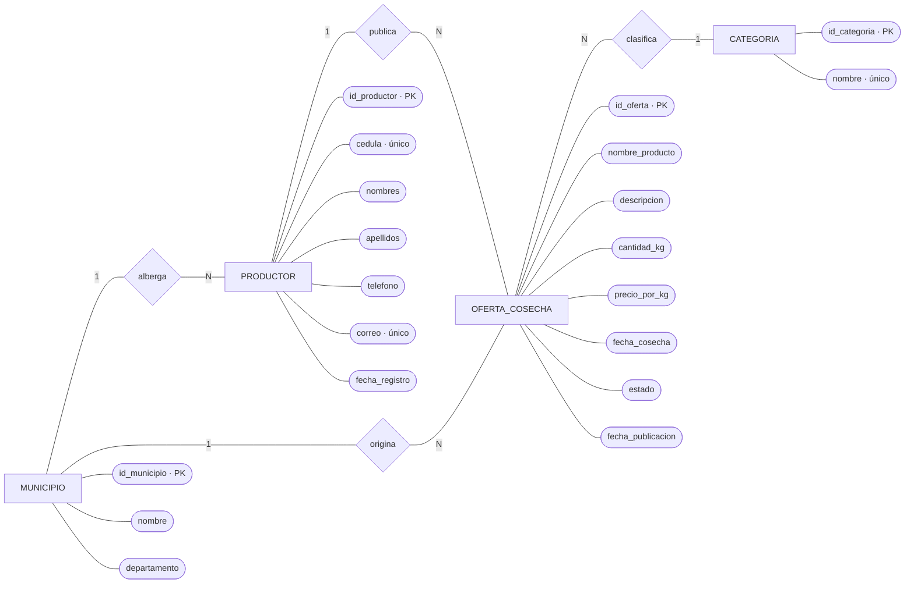

# Modelo Entidad-Relación (MER) — AgroValle Connect

Modelo conceptual en notación Chen. Los rectángulos representan entidades, los rombos relaciones y los óvalos atributos; las cardinalidades se muestran junto a cada relación.

## Entidades y relaciones

- **MUNICIPIO** alberga productores y es el municipio de origen de las ofertas.
- **PRODUCTOR** publica ofertas de cosecha.
- **OFERTA_COSECHA** identifica el producto publicado, sus cantidades, precios, fechas y estado.
- **CATEGORIA** clasifica las ofertas de cosecha.
- `PK` indica la clave primaria; los atributos identificadores de los catálogos se mantienen únicos según el modelo lógico.

## Reglas de negocio del modelo

1. Un municipio puede albergar varios productores; cada productor registra un municipio.
2. Un productor puede publicar varias ofertas; cada oferta tiene un productor responsable.
3. Un municipio puede tener varias ofertas de origen; cada oferta identifica su municipio.
4. Una categoría clasifica varias ofertas; cada oferta se asigna a una categoría.
5. La cédula y el correo identifican de forma única a cada productor.

## Alcance respecto a la implementación actual

Este MER es la representación conceptual de la imagen de referencia y corresponde al DER ampliado de [modelo-datos-der.md](./modelo-datos-der.md). El sistema implementado actualmente utiliza nombres de producto y categoría como atributos de `productos` y no tiene todavía las entidades/catálogos Municipio y Categoría. El modelo conceptual no implica que esas tablas ya existan en `schema.sql` o en JPA.
